# TP2 - Développement d'Applications Réparties (LSI3)

**Étudiant :** Chayma Bouassida  
**Matière :** Développement d'applications réparties  
**Année universitaire :** 2026 – 2027

Projet Maven pour le TP2 : échange de chaînes de caractères et d'objets
entre Client/Serveur via les sockets TCP.

---

# Activité 2-1 : Échange de CC entre Client/Serveur

## Objectif
Étendre l'application TP1 pour envoyer une **opération complète** au serveur
(ex : `55 * 25`) au lieu d'un seul entier, et lui permettre de renvoyer le résultat.

## Protocole de communication

Le client envoie **3 lignes successives** au serveur :
1. Ligne 1 : premier opérande (ex : `55`)
2. Ligne 2 : opérateur (ex : `*`)
3. Ligne 3 : deuxième opérande (ex : `25`)

Le serveur répond par **une ligne** contenant le résultat.
La communication se termine quand le client envoie `quit`.

- **Flux utilisés :** `BufferedReader` / `PrintWriter` (basés sur les flux de la socket)
- **Encodage :** texte UTF-8 via `InputStreamReader`

## Validation de la syntaxe (côté client)

Avant tout envoi, le client valide la saisie avec une expression régulière :

`^\s*(-?\d+(?:\.\d+)?)\s*([+\-*/])\s*(-?\d+(?:\.\d+)?)\s*$`

Cette validation **empêche l'envoi** de chaînes incorrectes comme `25 ** 55` ou `abc + 3`.

Décomposition du motif :
- `^\s*` : début de chaîne, espaces optionnels
- `(-?\d+(?:\.\d+)?)` : premier opérande (entier ou décimal, signe optionnel)
- `\s*([+\-*/])\s*` : opérateur (`+`, `-`, `*`, `/`) entouré d'espaces optionnels
- `(-?\d+(?:\.\d+)?)` : deuxième opérande
- `\s*$` : espaces optionnels puis fin de chaîne

## Code Source

### Server.java
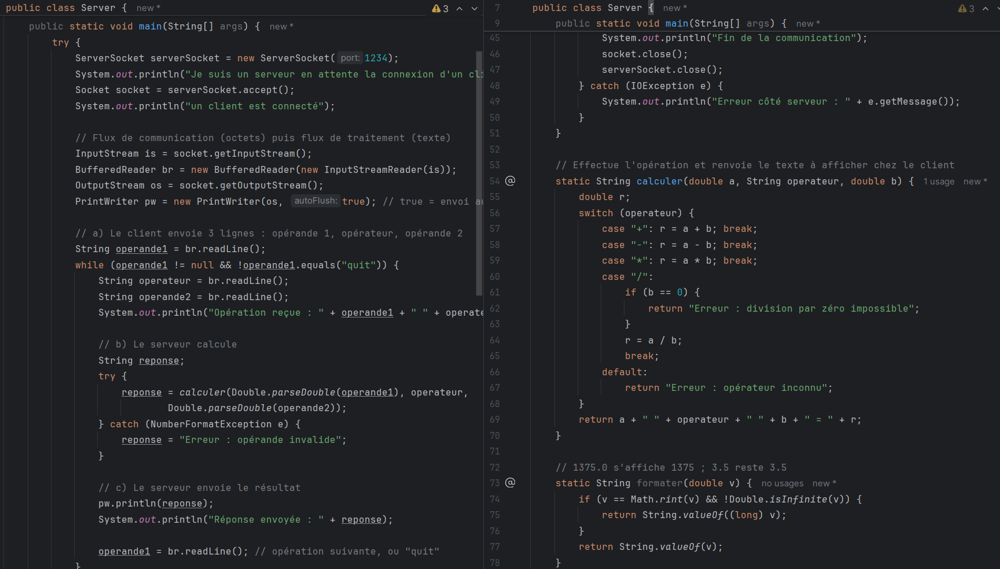

### Client.java
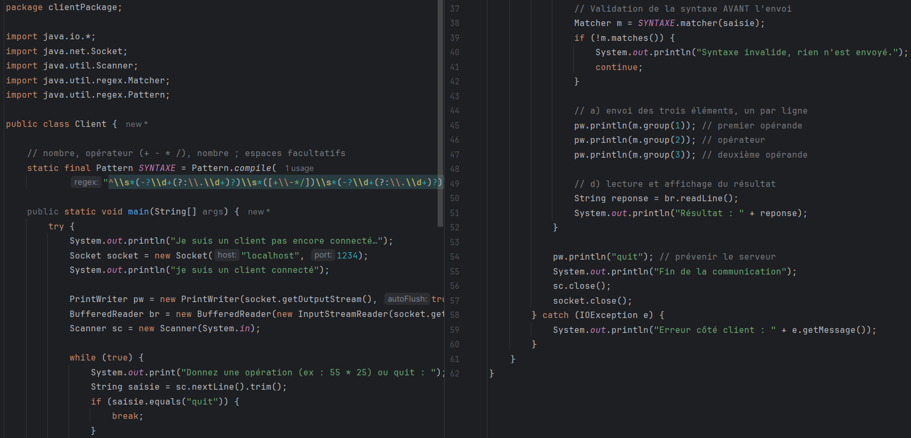

## Compilation
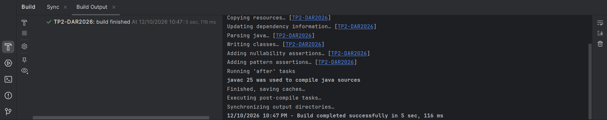

## Déroulement de l'exécution

### 1. Serveur en attente
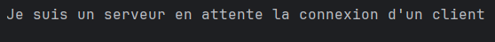

### 2. Client connecté
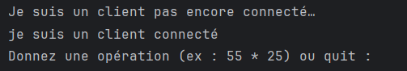

### 3. Serveur détecte la connexion
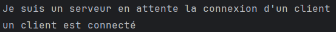

## Tests effectués

### Console Client — Tous les tests
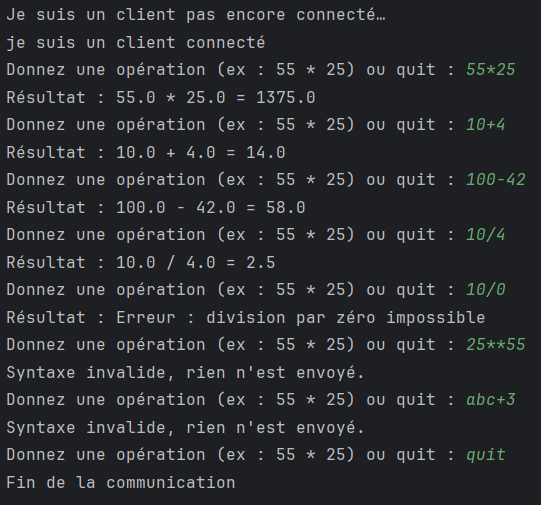

### Console Serveur — Toutes les opérations reçues
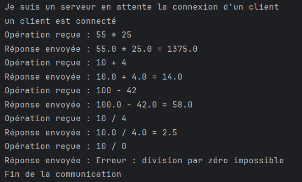

## Résultats des tests

| Entrée | Attendu | Obtenu |
|---|---|---|
| `55 * 25` | 1375.0 | `55.0 * 25.0 = 1375.0` ✅ |
| `10 + 4` | 14.0 | `10.0 + 4.0 = 14.0` ✅ |
| `100 - 42` | 58.0 | `100.0 - 42.0 = 58.0` ✅ |
| `10 / 4` | 2.5 | `10.0 / 4.0 = 2.5` ✅ |
| `10 / 0` | Erreur | `Erreur : division par zéro impossible` ✅ |
| `25 ** 55` | Rejeté | `Syntaxe invalide, rien n'est envoyé` ✅ |
| `abc + 3` | Rejeté | `Syntaxe invalide, rien n'est envoyé` ✅ |
| `quit` | Fin | `Fin de la communication` ✅ |

## Interprétation

Le client envoie l'opération décomposée en **trois lignes** via `PrintWriter`.
Le serveur les reçoit via `BufferedReader.readLine()` et effectue le calcul.

**Point clé :** la validation syntaxique est faite **côté client AVANT l'envoi**, comme le montre
la console serveur — les chaînes invalides (`25 ** 55`, `abc + 3`) n'apparaissent jamais côté serveur.

L'utilisation de `PrintWriter` avec `autoFlush=true` garantit que chaque `println` est envoyé
immédiatement sans avoir à appeler explicitement `flush()`.

---
# Activité 2-2 : Échange d'objets entre Client/Serveur

## Objectif
Étendre l'application pour que le client envoie un **objet sérialisé** contenant
toutes les informations de l'opération (opérande1, opérateur, opérande2) au serveur,
plutôt que trois chaînes séparées.

## Nouveautés par rapport à l'Activité 2-1

| Aspect | Activité 2-1 | Activité 2-2 |
|---|---|---|
| Type de données envoyé | 3 chaînes de caractères | 1 objet `Operation` sérialisé |
| Flux utilisés | `BufferedReader` / `PrintWriter` | `ObjectInputStream` / `ObjectOutputStream` |
| Classe partagée | aucune | `commonPackage.Operation` |

## Classe partagée `Operation`

La classe `Operation` implémente l'interface `Serializable`, ce qui permet
sa transmission via le réseau. Elle contient :

- `double operande1` : premier opérande
- `char operateur` : l'opérateur (`+`, `-`, `*`, `/`)
- `double operande2` : deuxième opérande
- `serialVersionUID = 1L` : identique des deux côtés (client et serveur)

### Operation.java
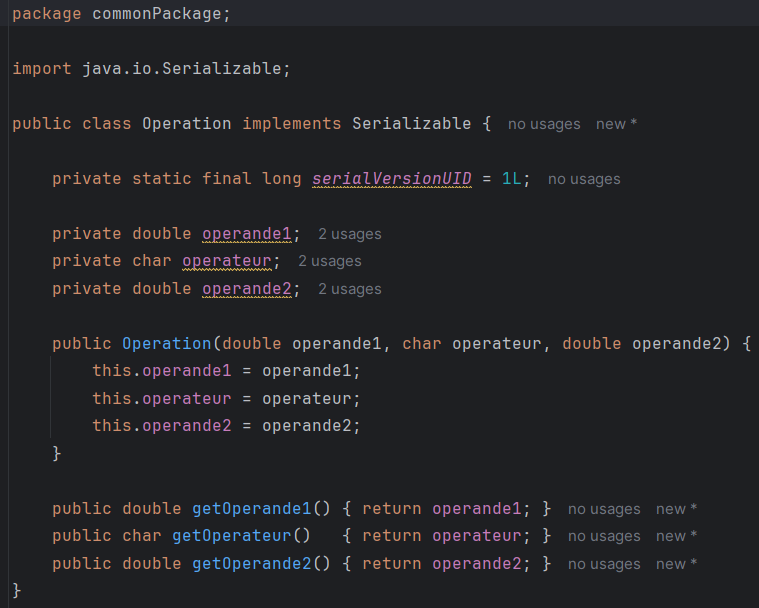

## Code Source

### Server2_2.java
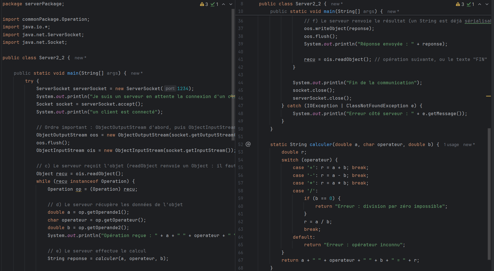

### Client2_2.java
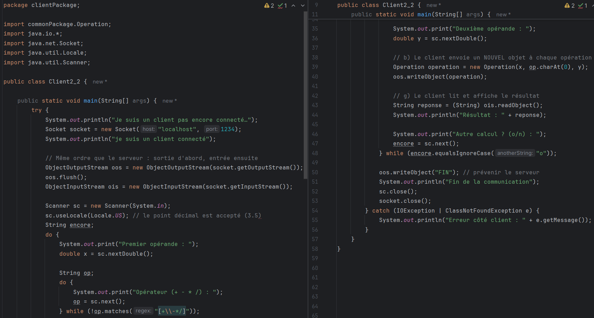

## Points clés de l'implémentation

- **Ordre des flux :** Le `ObjectOutputStream` doit être créé **avant** le `ObjectInputStream`
  (des deux côtés — client et serveur). Sinon, il y a risque de blocage mutuel.
- **Envoi du résultat :** Le serveur renvoie un `String` (déjà sérialisable) via `writeObject()`.
- **Sentinel :** Le client envoie la chaîne `"FIN"` (et non un objet `Operation`) pour signaler la fin.
  Le serveur utilise `while (recu instanceof Operation)` pour détecter la fin.
- **Locale US :** Le client utilise `sc.useLocale(Locale.US)` pour que le point décimal
  soit accepté (ex : `3.5` et non `3,5`).

## Compilation
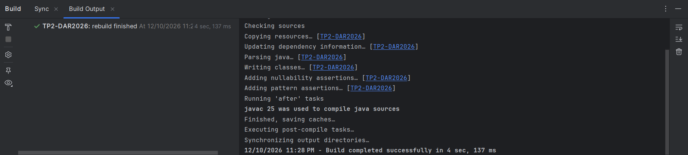

## Déroulement de l'exécution

### 1. Serveur en attente
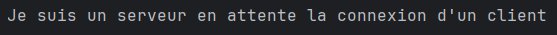

### 2. Client connecté
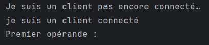

### 3. Serveur détecte la connexion
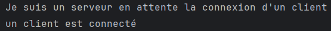

## Tests effectués

### Console Client — Tous les tests
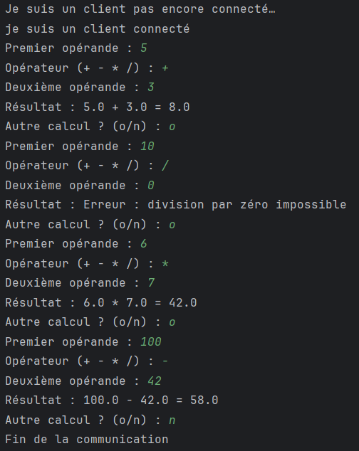

### Console Serveur — Toutes les opérations reçues
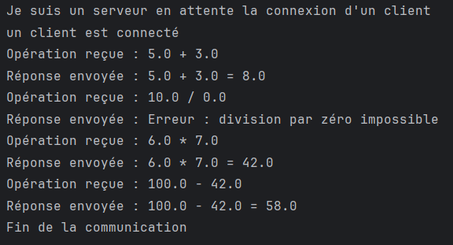

## Résultats des tests

| Test | Saisie | Résultat |
|---|---|---|
| Addition | `5 + 3` | `5.0 + 3.0 = 8.0` ✅ |
| Division par zéro | `10 / 0` | `Erreur : division par zéro impossible` ✅ |
| Multiplication | `6 * 7` | `6.0 * 7.0 = 42.0` ✅ |
| Soustraction | `100 - 42` | `100.0 - 42.0 = 58.0` ✅ |
| Fin | `n` | `Fin de la communication` ✅ |

## Interprétation

Le client crée un nouvel objet `Operation` à chaque calcul, le sérialise et l'envoie
au serveur via `ObjectOutputStream.writeObject()`. Le serveur le désérialise
automatiquement avec `ObjectInputStream.readObject()`, récupère les trois champs
via les getters, effectue le calcul, et renvoie le résultat sous forme de `String`.

L'utilisation de `Serializable` et `serialVersionUID` garantit la compatibilité
des classes entre le client et le serveur. La sentinelle `"FIN"` envoyée par le client
permet au serveur de terminer proprement sa boucle de réception d'objets.